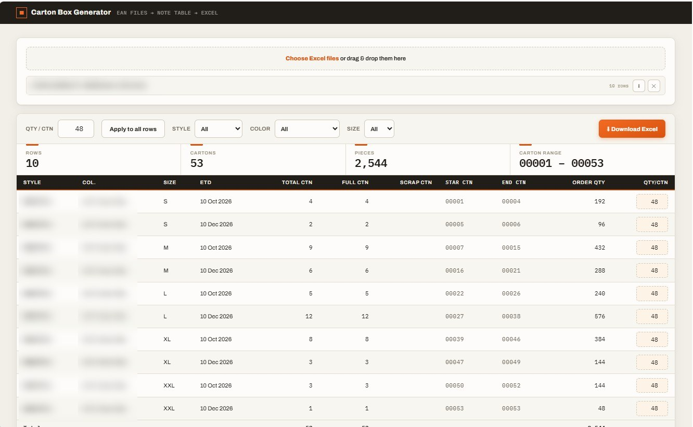

# Carton Box Generator

**Turns a customer's EAN order file into a ready-to-print carton packing list — in the browser, in one click.**

<p>
  
  
  
  
  
  
  
  
</p>

Used at **Hi-Tech Apparel** to prepare the carton paperwork for garment shipments. Drop in the
customer's `EAN for …xlsx`, and get back the `UCC …xlsx` with every box numbered, counted and
barcoded.

```
EAN order file  →  carton table on screen  →  UCC Excel file (manifest + Note sheet)
```



<sub>Real output — the customer's style codes, colours and the source filename are blurred. Look at
the first two rows: the same style in the same size, but one ships 10 Oct and one 10 Dec, so they
stay separate records with their own cartons instead of being added together.</sub>

---

## The problem it solves

The carton paperwork used to be built by hand in Excel: work out how many boxes each product
needs, number them without gaps, write the quantity of every single box, and glue together a
128C barcode for each one. A 268-box order means 268 rows typed by hand — and one wrong number
means a box arrives with a barcode that does not match what is inside it.

The app does the same job from the same source file, with the awkward cases handled:

- **The same product listed twice** is added up into one record first, so an order does not
  ship two half-empty boxes where one full box would do.
- **A different shipping date is a different shipment** — identical products leaving on
  different dates are kept apart, because they cannot travel in the same box.
- **The last box of every product carries the leftover pieces**, and its barcode says the real
  count, not the nominal one.
- **Nothing is lost or invented**: the quantities across a product's boxes always add back up
  to what was ordered.

---

## What you get

Two sheets in the downloaded file:

**1. The per-carton manifest** — one row per physical box, with its Parcel Number and the
`128C` barcode built from `PO + Parcel + SKU + QTY/Box`. Real output for 148 pieces at 48 per
carton — three full boxes and one holding the last 4:

| 6. SKU number | 8. QTY/Box | 9. ETD | 11. Parcel Number | 12. 128C Bar code |
|---------------|------------|--------|-------------------|-------------------|
| `246104` | `00048` | 01 Nov 2026 | `000001` | `020460100000124610400048` |
| `246104` | `00048` | 01 Nov 2026 | `000002` | `020460100000224610400048` |
| `246104` | `00048` | 01 Nov 2026 | `000003` | `020460100000324610400048` |
| `246104` | `00004` | 01 Nov 2026 | `000004` | `020460100000424610400004` |

**2. The `Note` summary** — one row per product, in the original layout the factory already
uses:

| Style | col. | size | Total CTN | Star CTN | End CTN | Order Qty | Qty/CTN |
|-------|------|------|-----------|----------|---------|-----------|---------|
| 6MS27014 | 3041 Vapor Blue | S | 4 | `00001` | `00004` | 148 | 48 |
| 6MS27014 | 3041 Vapor Blue | M | 7 | `00005` | `00011` | 316 | 48 |

---

## Features

- **Drag and drop, or several files at once** — each file downloads as its own `UCC …xlsx`,
  with carton numbers restarting at `00001`.
- **Finds the data sheet by itself** — looks for the `SKU number` + `Orli code` header row
  instead of relying on a fixed sheet name or position.
- **Pieces per carton is editable** — set it for everything, or change one row and watch the
  carton numbers recalculate.
- **Filter the view** by Style, Color, Size or file. Filters only change what is shown; the
  download always contains every row.
- **Leading zeros survive** — carton numbers, SKUs and barcodes are written as text, so Excel
  shows `00001`, not `1`.
- **Colours and column widths match the reference workbook**, so the output looks like the file
  it replaces.
- **Runs completely offline.** One self-contained HTML file, no server, no install, and the
  order data never leaves the computer.

---

## Using it

Open **`index.html`** in a browser — that is the whole app, one self-contained file.

1. Drop in one or more `EAN for …xlsx` files.
2. Check the table. Adjust **Qty/CTN** if this order packs differently.
3. **Download Excel** (or **Download all** for several files).

> `index.html` is build output, so it is not committed here. From a fresh clone, build it once
> with `npm install && npm run build`.

---

## Under the hood

| | |
|---|---|
| **Built with** | React 18 + [SheetJS](https://sheetjs.com/) (`xlsx` / `xlsx-js-style`), bundled by Vite into a single HTML file |
| **Core logic** | [`src/excel.js`](src/excel.js) — read the order file, combine duplicate lines, carton maths, build both sheets |
| **Tested by** | [`scripts/verify.mjs`](scripts/verify.mjs) — 95 automated checks, including a cell-by-cell rebuild of hand-made reference files (all 268 barcodes of the big one) |

```bash
npm install
npm run dev                # live preview
npm run build              # rebuild the single-file index.html
node scripts/verify.mjs    # check the carton logic is still correct
```

---

## Documentation

**[docs/DEVELOPER-GUIDE.md](docs/DEVELOPER-GUIDE.md)** — the full explanation: the exact
combine key (Style + Color + Size + ETD), the carton formulas, what goes in every box, the file
tree, and what the verification script proves.

---

<sub>Internal tool for HI-TECH APPAREL · real order files (`Input/`, `Output/`, and any spreadsheet)
are excluded by `.gitignore` and never leave the local machine — the checks run against the copies
kept there.</sub>
